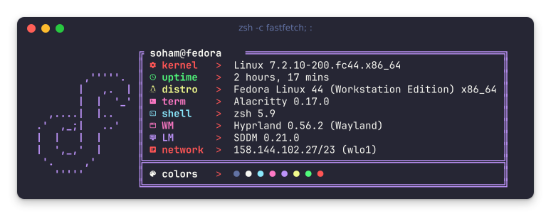

# Soham Chatterjee

PhD Student · Theoretical Computer Science

### Research

- **Computational Complexity:** circuit lower bounds, derandomization, P vs NP
- **Algebraic Methods:** complexity theory and coding theory
- **Pure Mathematics:** algebraic geometry and number theory

### LaTeX Projects

- **MSc thesis:** [Exponential Sums and Weil Bounds](https://github.com/sohamch08/msc-project-tifr).
- **Lecture notes:** [Algorithms](https://github.com/sohamch08/algorithms-tifr) · [Topics in Coding Theory](https://github.com/sohamch08/advance-coding-theory-tifr) · [Combinatorics](https://github.com/sohamch08/mfcs-tifr) · [Multivariable Analysis](https://github.com/sohamch08/multivariable-analysis-CMI).
- **[Lumina](https://github.com/sohamch08/lumina)** · My LaTeX theme for lecture notes, reports, and theses.

More in my [LaTeX archive](https://github.com/sohamch08/LaTeX).

### Selected Projects

- **[HyprLife](https://github.com/sohamch08/HyprLife)** · My Hyprland desktop configuration and workflow.
- **[hyprZoom](https://github.com/sohamch08/hyprZoom)** · Window management, chat notifications, and screen-sharing fixes for Zoom on Hyprland.
- **[tifrvpn-tui](https://github.com/sohamch08/tifrvpn-tui)** · Terminal controls for the TIFR VPN with KeePassXC integration.
- **[NeoMutt](https://github.com/sohamch08/neomutt)** · My terminal email setup with mbsync, msmtp, and Notmuch.
- **[cmus](https://github.com/sohamch08/cmus)** · My terminal music setup with custom keybindings, themes, and notifications.
- **[Zsh](https://github.com/sohamch08/zsh)** · My Zsh configuration.

### Tools

  
  
  
  
  
  
  
  

 

  
    
  <i>“Powered by coffee, curiosity, and an unreasonable faith in P ≠ NP.”</i>

